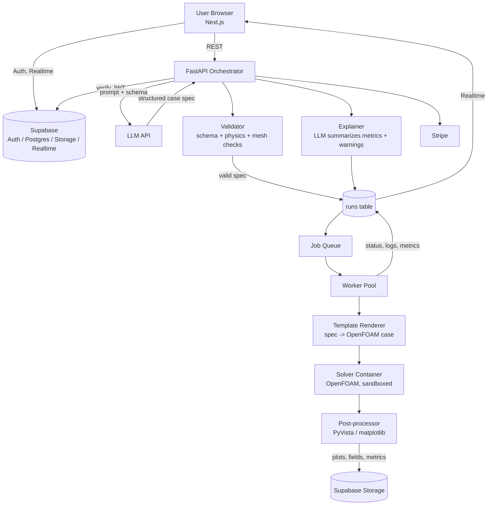

# FlowMind (working title)

**Describe a flow problem in plain English. Get a validated, solved CFD simulation back.**

FlowMind is an LLM-powered simulation SaaS. The LLM is the *interface*, never the solver: it turns natural language into a structured, validated simulation case, a real numerical solver (OpenFOAM) does the physics, and the LLM explains the results.

> "Airflow over a 2D cylinder at Re = 100, show vortex shedding."
> -> case spec -> mesh -> solve -> plots -> explanation -> "now double the velocity"

---

## Table of Contents

1. [Why this exists](#why-this-exists)
2. [Core principles](#core-principles)
3. [Features](#features)
4. [Tech stack](#tech-stack)
5. [System architecture](#system-architecture)
6. [Request lifecycle](#request-lifecycle)
7. [Case templates](#case-templates)
8. [Database schema](#database-schema)
9. [Storage layout](#storage-layout)
10. [API reference](#api-reference)
11. [Repository structure](#repository-structure)
12. [Getting started](#getting-started)
13. [Environment variables](#environment-variables)
14. [Validation and safety](#validation-and-safety)
15. [Billing and quotas](#billing-and-quotas)
16. [Roadmap](#roadmap)
17. [Testing](#testing)
18. [Deployment](#deployment)
19. [Contributing](#contributing)
20. [License](#license)

---

## Why this exists

Setting up CFD takes days: geometry, meshing, boundary conditions, turbulence models, solver settings. Commercial tools (ANSYS, STAR-CCM+) are expensive and have steep learning curves. Students, small engineering shops, and startups need a faster path to a trustworthy first result.

FlowMind removes the setup barrier while keeping the physics honest.

## Core principles

1. **The LLM never produces numbers.** All physical results come from a real solver.
2. **The LLM never writes raw solver files or shell commands.** It fills in a strict JSON schema; our code renders templates.
3. **Everything is validated** before compute is spent (schema, physical sanity, mesh quality) and after (convergence, y+, residuals).
4. **Narrow first, then expand.** One case type end to end before adding the next.
5. **Reproducible runs.** Every run stores its exact spec, solver version, and container image digest.

## Features

**MVP**
- Chat-style prompt -> structured case spec (editable by the user)
- 2D external flow over simple shapes (cylinder first)
- Automatic meshing from templates
- Async job execution with live status
- Result viewer: velocity, pressure, vorticity plots, Cd/Cl curves
- LLM-written explanation with warnings (coarse mesh, not converged)
- Follow-up edits ("double the velocity", "refine near the wall") that create a new run
- Auth, projects, run history, free tier with quotas

**Later**
- Heat transfer cases, pipe flow, nozzle, airfoil
- 3D cases and interactive 3D viewer
- Parameter sweeps and comparison dashboards
- Team workspaces, sharing links
- Pluggable solvers (SU2, custom C++ solver)
- API access and webhooks

## Tech stack

| Layer | Choice | Notes |
|---|---|---|
| Frontend | Next.js (App Router) + TypeScript + Tailwind | Chat UI, case editor, results viewer |
| Charts / viewer | Plotly or Recharts; later vtk.js / Three.js | Start with 2D images + plots |
| Auth | Supabase Auth | Email, Google, GitHub |
| Database | Supabase Postgres + Row Level Security | Source of truth |
| File storage | Supabase Storage | Case files, results, plots |
| Realtime | Supabase Realtime | Live job status and log streaming |
| API / orchestrator | FastAPI (Python) | LLM calls, validation, job creation |
| Job queue | Postgres-based queue (pgmq) or Redis + RQ/Celery | Start with pgmq to stay inside Supabase |
| Solver workers | Docker + OpenFOAM | One container per run, resource limited |
| Post-processing | PyVista / ParaView (headless) + matplotlib | Renders fields to PNG and extracts metrics |
| LLM | Anthropic Claude API | Structured output (JSON schema / tool use) |
| Payments | Stripe | Subscriptions + metered usage |
| Infra | Vercel (web), Fly.io / Railway (API), cloud VMs or Kubernetes (workers) | See [Deployment](#deployment) |

## System architecture



### Components

**Web app (Next.js)**
Chat interface, spec editor (form view of the JSON), run dashboard, result viewer. Talks to Supabase directly for auth, reads, and realtime; talks to the FastAPI service for anything that creates runs or calls the LLM.

**Supabase**
- *Auth*: users and sessions; the JWT is verified by the API.
- *Postgres*: projects, cases, runs, usage, billing state, all protected by RLS.
- *Storage*: private buckets for case files and results, access via signed URLs.
- *Realtime*: pushes `runs` row updates (status, progress, log tail) to the browser.

**Orchestrator (FastAPI)**
Stateless service. Responsibilities: prompt -> spec translation, validation, quota checks, enqueueing jobs, generating explanations, Stripe webhooks. It holds the LLM API key; the browser never sees it.

**Workers**
Pull jobs from the queue, render the OpenFOAM case from the validated spec, run the solver in a sandboxed container, post-process, upload artifacts, update the run row. Workers use the Supabase **service role** key and are never exposed to users.

**Solver container**
Pinned OpenFOAM image (by digest). No network access, CPU/memory/time limits, read-only root filesystem, writes only to a scratch volume.

## Request lifecycle

1. **Prompt.** User types a problem description in a project.
2. **Translate.** API sends the prompt (plus conversation context and the allowed case schemas) to the LLM, requesting structured output only.
3. **Validate.** The spec is checked against the JSON schema, then physics rules (e.g. Reynolds number in the template's supported range, domain size vs. body size), then mesh budget (cell count limit by plan).
4. **Review.** The UI shows the spec as an editable form with a preview. The user confirms or edits.
5. **Enqueue.** A `runs` row is created (`queued`), quota is reserved, a job is pushed to the queue.
6. **Execute.** A worker claims the job (`running`), renders the case, meshes, solves, streams progress and residuals into the row.
7. **Post-process.** Fields are rendered to images, metrics extracted (Cd, Cl, Strouhal number, residuals, y+).
8. **Check.** Result validators flag non-convergence, poor mesh quality, or suspicious values.
9. **Explain.** The LLM receives *only* the verified metrics and warnings and writes a plain-English summary. It is instructed not to introduce any numbers not present in its input.
10. **Deliver.** Run is marked `succeeded` (or `failed` with a reason). The UI updates via Realtime.
11. **Iterate.** A follow-up message produces a modified spec and a new run linked to the parent run.

## Case templates

Each supported case is a **template** with three parts:

- `schema.json`: the parameters the LLM is allowed to set, with types, ranges, and defaults
- `template/`: parameterized OpenFOAM case files (Jinja2)
- `checks.py`: physics and result validation specific to that case

Example spec for the MVP template `cylinder_2d`:

```json
{
  "template": "cylinder_2d",
  "version": 1,
  "geometry": {
    "cylinder_diameter_m": 0.1,
    "domain_upstream_d": 10,
    "domain_downstream_d": 25,
    "domain_height_d": 20
  },
  "fluid": {
    "kinematic_viscosity_m2s": 1.0e-3,
    "density_kgm3": 1.0
  },
  "flow": {
    "inlet_velocity_ms": 1.0,
    "reynolds_number": 100
  },
  "mesh": {
    "resolution": "medium",
    "wall_refinement_layers": 8
  },
  "solver": {
    "type": "transient_incompressible",
    "end_time_s": 100,
    "write_interval_s": 0.5
  },
  "outputs": ["velocity_magnitude", "pressure", "vorticity", "cd_cl_history"]
}
```

Planned templates, in order: `cylinder_2d` -> `flat_plate_heat_2d` -> `pipe_flow` -> `nozzle_2d` -> `airfoil_2d`.

## Database schema

Run in the Supabase SQL editor (or as a migration in `supabase/migrations/`).

```sql
-- Profiles (extends auth.users)
create table public.profiles (
  id uuid primary key references auth.users(id) on delete cascade,
  display_name text,
  plan text not null default 'free' check (plan in ('free','pro','team')),
  stripe_customer_id text,
  created_at timestamptz not null default now()
);

create table public.projects (
  id uuid primary key default gen_random_uuid(),
  owner_id uuid not null references public.profiles(id) on delete cascade,
  name text not null,
  description text,
  created_at timestamptz not null default now()
);

create table public.messages (
  id uuid primary key default gen_random_uuid(),
  project_id uuid not null references public.projects(id) on delete cascade,
  role text not null check (role in ('user','assistant','system')),
  content text not null,
  run_id uuid,
  created_at timestamptz not null default now()
);

create table public.runs (
  id uuid primary key default gen_random_uuid(),
  project_id uuid not null references public.projects(id) on delete cascade,
  owner_id uuid not null references public.profiles(id) on delete cascade,
  parent_run_id uuid references public.runs(id),
  template text not null,
  spec jsonb not null,
  status text not null default 'queued'
    check (status in ('queued','running','succeeded','failed','canceled')),
  progress real not null default 0,
  log_tail text,
  metrics jsonb,
  warnings jsonb,
  explanation text,
  error text,
  solver_image text,           -- image digest for reproducibility
  cell_count integer,
  compute_seconds real,
  created_at timestamptz not null default now(),
  started_at timestamptz,
  finished_at timestamptz
);

create table public.artifacts (
  id uuid primary key default gen_random_uuid(),
  run_id uuid not null references public.runs(id) on delete cascade,
  kind text not null,          -- 'image', 'field', 'csv', 'log', 'archive'
  name text not null,
  storage_path text not null,
  size_bytes bigint,
  created_at timestamptz not null default now()
);

create table public.usage_events (
  id uuid primary key default gen_random_uuid(),
  owner_id uuid not null references public.profiles(id) on delete cascade,
  run_id uuid references public.runs(id) on delete set null,
  kind text not null,          -- 'run', 'llm_tokens', 'storage'
  quantity numeric not null,
  created_at timestamptz not null default now()
);

create index on public.runs (owner_id, created_at desc);
create index on public.runs (project_id, created_at desc);
create index on public.runs (status);

-- Row Level Security
alter table public.profiles enable row level security;
alter table public.projects enable row level security;
alter table public.messages enable row level security;
alter table public.runs enable row level security;
alter table public.artifacts enable row level security;
alter table public.usage_events enable row level security;

create policy "own profile" on public.profiles
  for all using (id = auth.uid()) with check (id = auth.uid());

create policy "own projects" on public.projects
  for all using (owner_id = auth.uid()) with check (owner_id = auth.uid());

create policy "own messages" on public.messages
  for all using (exists (
    select 1 from public.projects p
    where p.id = project_id and p.owner_id = auth.uid()));

-- Users can read their runs; only the backend (service role) writes them.
create policy "read own runs" on public.runs
  for select using (owner_id = auth.uid());

create policy "read own artifacts" on public.artifacts
  for select using (exists (
    select 1 from public.runs r
    where r.id = run_id and r.owner_id = auth.uid()));

create policy "read own usage" on public.usage_events
  for select using (owner_id = auth.uid());

-- Create a profile automatically on signup
create function public.handle_new_user() returns trigger
language plpgsql security definer set search_path = public as $$
begin
  insert into public.profiles (id, display_name)
  values (new.id, coalesce(new.raw_user_meta_data->>'name', new.email));
  return new;
end $$;

create trigger on_auth_user_created
  after insert on auth.users
  for each row execute function public.handle_new_user();

-- Enable realtime for live run updates
alter publication supabase_realtime add table public.runs;
```

Key rule: **users never write to `runs` directly.** Only the API and workers (service role) create and update runs, so quotas and validation can't be bypassed.

## Storage layout

Private bucket `runs`:

```
runs/
  {owner_id}/{run_id}/
    spec.json
    mesh_report.json
    metrics.json
    images/velocity.png
    images/pressure.png
    images/vorticity.png
    data/forces.csv
    data/residuals.csv
    logs/solver.log
    archive/case.tar.gz
```

Storage policies restrict access to paths beginning with the caller's `auth.uid()`. The frontend uses signed URLs.

## API reference

Base URL: `/api/v1`. All endpoints require `Authorization: Bearer <supabase_jwt>`.

| Method | Endpoint | Description |
|---|---|---|
| `POST` | `/projects/{id}/translate` | Prompt -> validated case spec (no compute is spent) |
| `POST` | `/projects/{id}/runs` | Create a run from a confirmed spec; enqueues the job |
| `GET` | `/runs/{id}` | Run status, metrics, warnings, explanation |
| `POST` | `/runs/{id}/cancel` | Cancel a queued or running job |
| `POST` | `/runs/{id}/followup` | Natural-language modification -> new spec (child run) |
| `GET` | `/runs/{id}/artifacts` | Signed URLs for outputs |
| `GET` | `/usage` | Current period usage and limits |
| `POST` | `/billing/checkout` | Create a Stripe Checkout session |
| `POST` | `/webhooks/stripe` | Stripe webhook receiver |

Example:

```http
POST /api/v1/projects/8f1c.../translate
{ "prompt": "airflow over a 10 cm cylinder at Re 100" }
```

```json
{
  "spec": { "template": "cylinder_2d", "...": "..." },
  "assumptions": ["Fluid assumed to be air-like with nu scaled to give Re=100"],
  "warnings": [],
  "estimated_cells": 42000,
  "estimated_compute_seconds": 180
}
```

## Repository structure

```
flowmind/
├── README.md
├── apps/
│   └── web/                      # Next.js frontend
│       ├── app/
│       ├── components/
│       └── lib/supabase/
├── services/
│   ├── api/                      # FastAPI orchestrator
│   │   ├── app/
│   │   │   ├── main.py
│   │   │   ├── routers/
│   │   │   ├── llm/              # prompts, structured output, explainer
│   │   │   ├── validation/       # schema, physics, quota checks
│   │   │   ├── billing/
│   │   │   └── db.py
│   │   └── tests/
│   └── worker/                   # Job runner
│       ├── worker/
│       │   ├── main.py           # claim jobs, run pipeline
│       │   ├── render.py         # spec -> OpenFOAM case
│       │   ├── run_solver.py     # sandboxed container execution
│       │   └── postprocess.py
│       └── tests/
├── templates/                    # Case templates
│   └── cylinder_2d/
│       ├── schema.json
│       ├── checks.py
│       └── case/                 # Jinja2 OpenFOAM files
├── docker/
│   ├── solver.Dockerfile         # pinned OpenFOAM image
│   └── worker.Dockerfile
├── supabase/
│   ├── config.toml
│   ├── migrations/
│   └── seed.sql
├── docs/
│   ├── architecture.md
│   └── adding-a-template.md
├── docker-compose.yml
└── .env.example
```

## Getting started

### Prerequisites

- Node.js 20+
- Python 3.11+
- Docker
- Supabase CLI (`npm i -g supabase`)
- An Anthropic API key
- (Optional) Stripe account for billing

### 1. Clone and install

```bash
git clone https://github.com/<your-username>/flowmind.git
cd flowmind
cp .env.example .env
```

### 2. Start Supabase locally

```bash
supabase start
supabase db reset          # applies migrations in supabase/migrations
```

Copy the printed `API URL`, `anon key`, and `service_role key` into `.env`.

### 3. Build the solver image

```bash
docker build -f docker/solver.Dockerfile -t flowmind-solver:dev .
```

### 4. Run the API

```bash
cd services/api
python -m venv .venv && source .venv/bin/activate
pip install -r requirements.txt
uvicorn app.main:app --reload --port 8000
```

### 5. Run a worker

```bash
cd services/worker
python -m venv .venv && source .venv/bin/activate
pip install -r requirements.txt
python -m worker.main
```

### 6. Run the web app

```bash
cd apps/web
npm install
npm run dev
```

Open http://localhost:3000, sign up, create a project, and try:
*"Flow over a cylinder at Reynolds number 100."*

## Environment variables

```bash
# Supabase
NEXT_PUBLIC_SUPABASE_URL=
NEXT_PUBLIC_SUPABASE_ANON_KEY=
SUPABASE_SERVICE_ROLE_KEY=        # API + workers only, never the browser
SUPABASE_JWT_SECRET=

# API
API_BASE_URL=http://localhost:8000
NEXT_PUBLIC_API_BASE_URL=http://localhost:8000

# LLM
ANTHROPIC_API_KEY=
LLM_MODEL=                        # set to the model you want to use

# Worker
SOLVER_IMAGE=flowmind-solver:dev
MAX_RUN_SECONDS=900
MAX_CELLS_FREE=50000
MAX_CELLS_PRO=500000

# Billing (optional)
STRIPE_SECRET_KEY=
STRIPE_WEBHOOK_SECRET=
STRIPE_PRICE_PRO=
```

## Validation and safety

**Before compute (pre-run)**
- JSON schema validation against the template schema
- Parameter ranges (Re range, velocity, domain ratios)
- Estimated cell count within plan limits
- Blockage ratio and domain size sanity checks
- Quota check

**After compute (post-run)**
- Residuals dropped below target, force coefficients settled
- Courant number within limits for transient runs
- Mesh quality (non-orthogonality, skewness) within thresholds
- y+ appropriate for the chosen turbulence model
- Flag results that disagree with known benchmarks (e.g. Cd and Strouhal number for cylinder flow at Re = 100)

**Sandboxing**
- Solver containers run with no network, non-root user, read-only root FS
- CPU, memory, and wall-time limits enforced
- Only spec-derived, template-rendered files enter the container
- LLM output is never executed or written as raw files

**LLM guardrails**
- Structured output only, validated before use
- Explainer receives verified metrics only and must not introduce new numbers
- Every explanation is shown with its warnings and a "verify before engineering use" notice

## Billing and quotas

| Plan | Runs / month | Max cells | Max runtime | Storage |
|---|---|---|---|---|
| Free | 10 | 50k | 5 min | 1 GB |
| Pro | 200 | 500k | 30 min | 20 GB |
| Team | Custom | Custom | Custom | Custom |

Usage is recorded in `usage_events`. Stripe handles subscriptions; compute-heavy overages can be metered later.

## Roadmap

- [ ] **Phase 0: Foundations.** Repo, Supabase project, auth, schema + RLS, CI
- [ ] **Phase 1: Core loop.** `cylinder_2d` end to end: prompt -> spec -> run -> plots -> explanation
- [ ] **Phase 2: Product.** Spec editor, run history, follow-up edits, quotas, Stripe
- [ ] **Phase 3: Reliability.** Result validators, benchmark regression tests, observability, queue hardening
- [ ] **Phase 4: Expand.** Heat transfer, pipe flow, nozzle, airfoil
- [ ] **Phase 5: Scale.** 3D cases, interactive viewer, parameter sweeps, team workspaces
- [ ] **Phase 6: Platform.** Public API, webhooks, pluggable solvers (SU2, custom C++)

## Testing

- **Unit tests:** schema validation, template rendering, quota logic
- **Golden tests:** each template runs a small reference case and compares results to stored benchmarks within tolerance
- **LLM eval set:** a library of prompts with expected specs, run on every prompt or model change, to catch regressions in translation quality
- **Integration tests:** API + local Supabase + worker with a tiny mesh
- **Load tests:** queue behavior under many concurrent runs

```bash
# API
cd services/api && pytest
# Worker
cd services/worker && pytest
# Web
cd apps/web && npm test
```

## Deployment

- **Web:** Vercel
- **API:** Fly.io, Railway, or a container on any cloud
- **Workers:** autoscaled VMs or Kubernetes jobs; scale on queue depth; consider spot instances for cost
- **Supabase:** hosted project; run migrations through CI
- **Secrets:** managed through the platform's secret store; the service role key never reaches the browser
- **Monitoring:** Sentry for errors, structured logs, queue-depth and run-duration dashboards

## Contributing

1. Fork and create a feature branch
2. Add tests for your change
3. Run linters and tests locally
4. Open a pull request describing the change and how you verified it

Adding a new simulation type? Follow `docs/adding-a-template.md`: write the schema, template, checks, and at least one benchmark test.

## License

To be decided (MIT or Apache-2.0 for the open parts; the hosted service is commercial).

## Disclaimer

Results are for education, exploration, and early-stage design. They must be independently verified before use in safety-critical or production engineering decisions.
